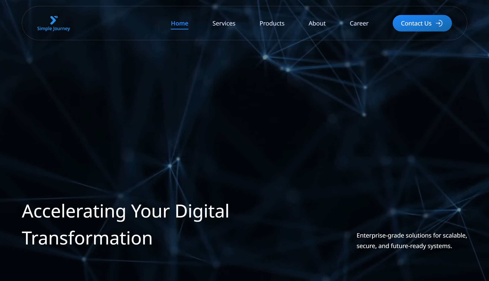
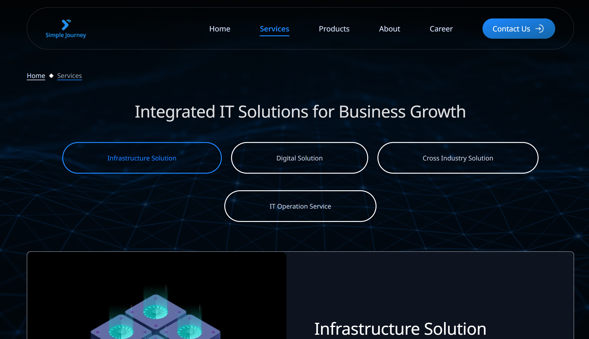
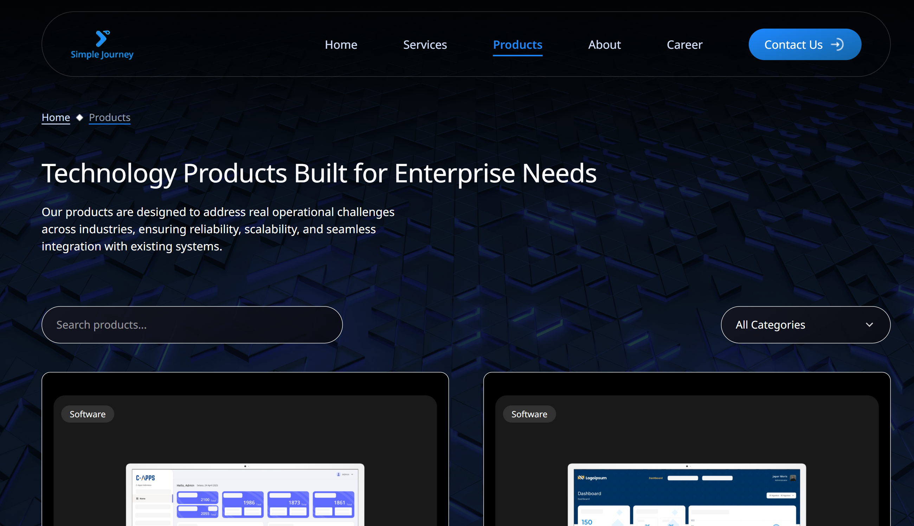
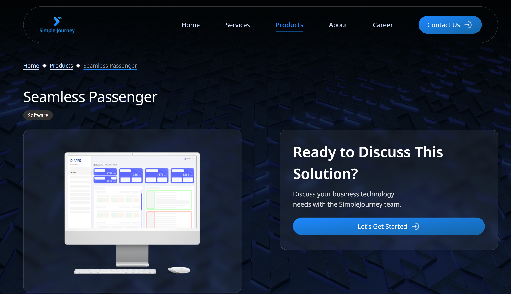
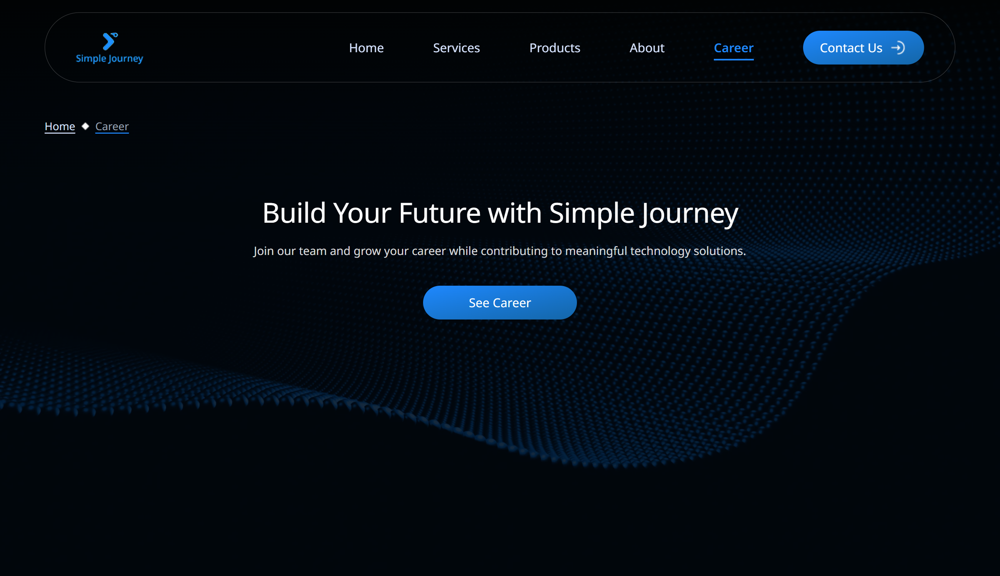
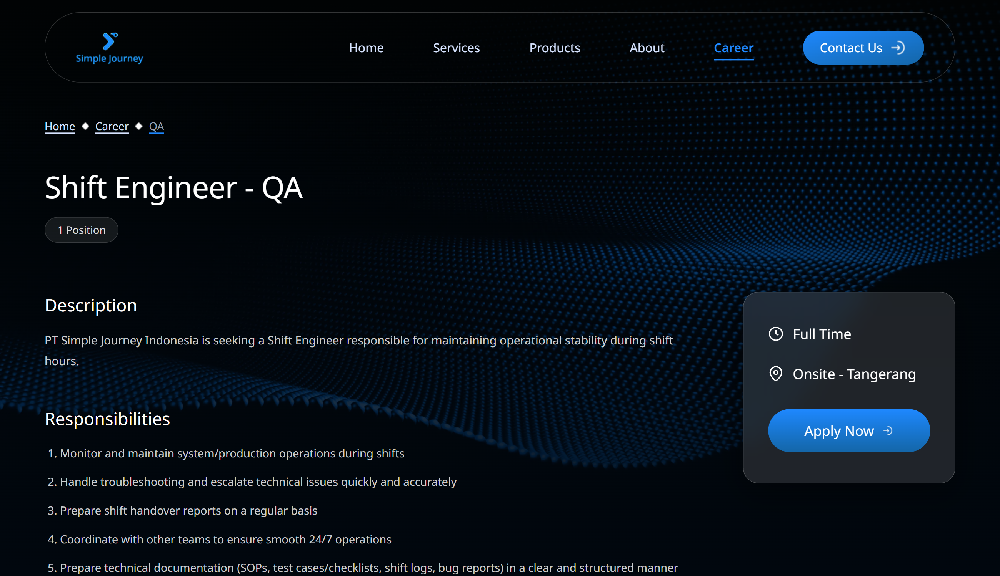
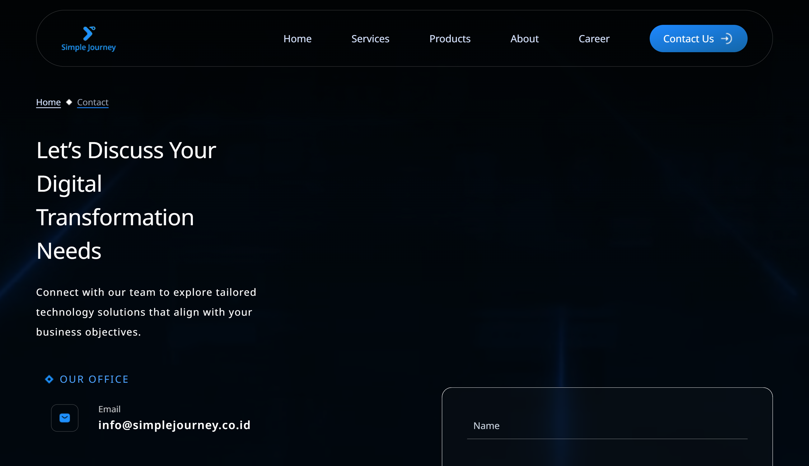
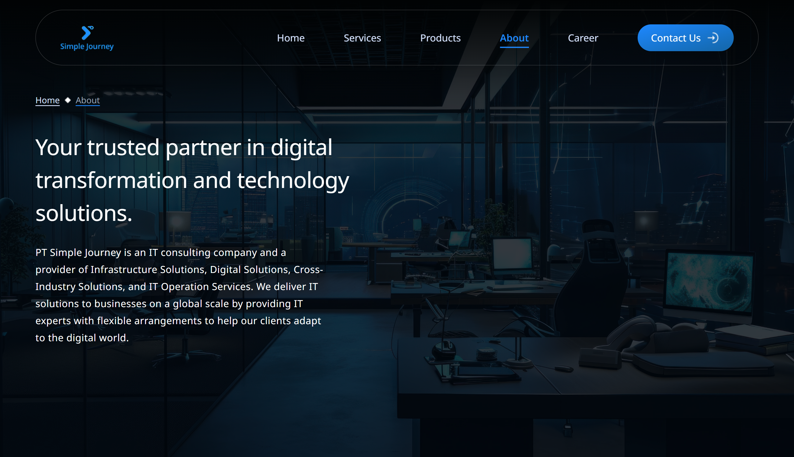

# Simple Journey Indonesia Website | Front-End Engineer Technical Test



🌐 Live URL : https://simplejourney.netlify.app/

A responsive web application built with **Vue 3**, focusing on visual accuracy, maintainable code, performance, and accessibility.

This website was developed as part of the Front-End Engineer technical test for PT Simple Journey Indonesia.

## Table of Contents

- [Getting Started](#getting-started)
  - [Option 1 : NPM](#option-1--npm)
  - [Option 2 : Docker](#option-2--docker)
- [Overview](#overview)
- [Tech Stack](#tech-stack)
- [Project Structure](#project-structure)
- [Best Practices](#best-practices)
  - [Maintainability](#1-maintainability)
  - [Performance](#2-performance)
  - [Accessibility](#3-accessibility)

## Getting Started

This project provides **2 options to run the application**, using **NPM** or **Docker**.

**Prerequisites :**

- **Option 1 (NPM) :** [Node.js](https://nodejs.org/) + [Git](https://git-scm.com/)
- **Option 2 (Docker) :** [Docker Desktop](https://www.docker.com/products/docker-desktop/) or Docker Engine + [Git](https://git-scm.com/)

### Option 1 : NPM

#### 1. Clone the repository

```bash
git clone https://github.com/darren-ctj/simple_journey_technical_test.git
```

#### 2. Move to the project directory

```bash
cd .\simple_journey_technical_test\
```

#### 3. Install dependencies

```bash
npm ci
```

#### 4. Start the development server

```bash
npm run dev
```

Open http://localhost:5173 in browser.

#### 5. Create a production build (optional)

```bash
npm run build
```

The production assets are generated in the `dist/` directory.

#### 6. Preview the production build (optional)

```bash
npm run preview
```

Open http://localhost:4173 in browser.

### Option 2 : Docker

#### 1. Clone the repository

```bash
git clone https://github.com/darren-ctj/simple_journey_technical_test.git
```

#### 2. Move to the project directory

```bash
cd .\simple_journey_technical_test\
```

#### 3. Build the Docker image

```bash
docker build -t simple-journey-frontend .
```

#### 4. Run the container

```bash
docker run -d --rm -p 3000:80 simple-journey-frontend
```

#### 5. Open the application

Open http://localhost:3000 in browser.

The application is now served by Nginx.

### Bonus: Jenkins CI Pipeline with Docker

This bonus demonstrates how Jenkins can validate and build the project through a CI pipeline. Jenkins runs in Docker, and the pipeline can be triggered manually by a reviewer.

#### 1. Start Jenkins

```bash
docker compose up -d --build
```

This builds the custom Jenkins image and starts the Jenkins container in the background.

Check the container status if needed :

```bash
docker compose ps
```

#### 2. Unlock Jenkins

Open http://localhost:8080

Retrieve the initial administrator password:

```bash
docker compose exec jenkins cat /var/jenkins_home/secrets/initialAdminPassword
```

Follow the setup wizard and install the recommended plugins.

#### 3. Configure the pipeline

In Jenkins:

1. Select **New Item**.
2. Enter a job name, such as `simple-journey-frontend`.
3. Select **Pipeline**, then click **OK**.
4. Under the Pipeline section, choose **Pipeline script from SCM**.
5. Set SCM to **Git**.
6. Enter **https://github.com/darren-ctj/simple_journey_technical_test** as the GitHub repository URL.
7. Set the branch to `*/main`.
8. Set the script path to `Jenkinsfile`.
9. Save the configuration.

Ensure Jenkins has the necessary Git and Pipeline plugins and can access the repository.

#### 4. Run the pipeline manually

Select the configured job and click **Build Now**.

The pipeline runs the stages defined in the `Jenkinsfile`:

1. Check out the source code.
2. Verify the Node.js and npm versions.
3. Install dependencies using `npm ci`.
4. Build the production application using `npm run build`.

Review the build status and logs under **Console Output**.

## Overview

The application includes the following pages:

| Page               | Preview                                         |
| ------------------ | ----------------------------------------------- |
| **Home**           |                      |
| **Services**       |              |
| **Products**       |              |
| **Product Detail** |  |
| **Career**         |                  |
| **Career Detail**  |    |
| **Contact**        |                |
| **About**          |                    |

## Tech Stack

- **JavaScript/TypeScript** — Application logic and syntax.
- **Vue 3** — Application frontend framework.
- **Vue Router** — Routing between pages.
- **Vite** — Development server and production build tooling.
- **TailwindCSS** — Styling and responsive layouts.
- **Vue Motion** — Animation library.
- **Docker** — Containerization and production serving.
- **Nginx** — Production web server for the built frontend.
- **Jenkins** — Continuous integration pipeline.
- **Git and GitHub** — Version control and source code hosting.

## Project Structure

The project follows a modular architecture that separates shared resources from feature-specific modules. Each feature owns its related components, composables, pages, constants, types, and utilities, keeping its implementation organized and easier to maintain.

```text
src/
├── components/
│   ├── shared/                 # Shared components
│   └── ui/                     # Base components
├── composables/                # Global composables
├── constants/                  # Global constants
├── layouts/                    # Application layouts
├── types/                      # Global types
├── router/                     # Route definitions
├── utils/                      # Global utilities
├── features/
│   ├── products/
│   │   ├── components/         # Product-specific components
│   │   ├── composables/        # Product-specific composables
│   │   ├── pages/              # Product-related pages
│   │   ├── constants/          # Product-specific constants
│   │   ├── types/              # Product-specific types
│   │   └── utils/              # Product-specific utilities
|   |
│   └── ...                     # Other features follow the same structure
├── App.vue                     # Root component
├── style.css                   # Design system
└── main.ts                     # Application entry point
```

## Best Practices

### 1. Maintainability

Use consistent naming conventions and descriptive names throughout the codebase.

| Item                    | Convention       | Example             |
| ----------------------- | ---------------- | ------------------- |
| Files and folders       | kebab-case       | `about-hero.vue`    |
| Variables and functions | camelCase        | `filteredJobs`      |
| Components              | PascalCase       | `AboutHero.vue`     |
| Composables             | `use-` prefix    | `use-job-search.js` |
| Event handlers          | `handle-` prefix | `handleSubmit`      |

Avoid abbreviations. Use descriptive names that clearly communicate intent.

### 2. Performance

- **Image formats:** Prefer WebP for images and WebM for videos.
- **Asset sizing:** Use image dimensions close to their rendered display size.
- **Lazy loading:** Use `loading="lazy"` for below-the-fold images.
- **Prioritization:** Use `fetchpriority="high"` for important, above-the-fold images.
- **Route loading:** Lazy-load pages except the entry page (Home).
- **Computed properties:** Use `computed` to cache expensive derived results.

### 3. Accessibility

- **Prevent layout shifts:** Define image dimensions or aspect ratios to reserve space and minimize Cumulative Layout Shift (CLS).
- **Semantic HTML:** Use semantic elements such as `header`, `nav`, `main`, and `footer` appropriately.
- **Proper elements:** Use elements according to their intended purpose, such as `button` for actions and `a` for navigation, to support keyboard accessibility.
- **Responsive design:** Ensure the application remains usable across different screen sizes.
